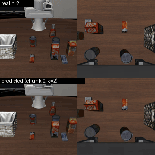

# cosmos3-libero

Evaluate [`lerobot/Cosmos3-Edge-Policy-LIBERO_10`](https://huggingface.co/lerobot/Cosmos3-Edge-Policy-LIBERO_10)
(NVIDIA's [Cosmos 3](https://arxiv.org/abs/2606.02800) world action model, fine-tuned on LIBERO-10) in the LIBERO-10
simulator, with the evaluation protocol of its model card.

This is a thin wrapper. [LeRobot](https://github.com/huggingface/lerobot) and
[LIBERO](https://github.com/huggingface/LIBERO) are git submodules pinned to the versions the model card was measured
with, `setup.sh` builds the environment, and `eval.sh` is the card's `lerobot-eval` command.

## Setup

Linux x86_64, one NVIDIA GPU (about 10 GB of memory at batch size 1), and `git`, `uv`, `cmake`, `g++`, `curl`.

```bash
git clone --recurse-submodules https://github.com/mpodolinsky/cosmos3-libero && cd cosmos3-libero
./setup.sh
```

`setup.sh` creates the Python 3.12 environment with `uv`. MuJoCo 2.3.7, the version of the card's results, has no wheel
for Python 3.12, so it is built from source (about a minute); see [MuJoCo](#mujoco). The policy weights (about 9 GB)
are downloaded from the Hub on the first run.

## Run

```bash
./eval.sh                                   # the model card's protocol: 10 tasks x 50 episodes, 4 environments in parallel
./eval.sh --eval.n_episodes=5               # 5 episodes per task
./eval.sh --env.task_ids='[0,1]' --eval.n_episodes=2 --eval.batch_size=1 --eval.use_async_envs=false \
          --output_dir=outputs/smoke        # a quick check: tasks 0 and 1
./eval.sh --policy.save_predicted_video=true   # also decode the future video the policy predicts
```

Any [`lerobot-eval`](https://huggingface.co/docs/lerobot/libero) flag can be appended; it overrides the default
(the last value wins). Results go to `outputs/eval/libero_10/` (`eval_info.json` with the success rate overall and per
task, and one video per episode).

The defaults of `eval.sh` are those of the model card: bfloat16, TF32 off, seed 0, 256x256 cameras, 510 steps per
episode, 30 UniPC sampling steps, the 16 actions of a chunk executed in full, the fixed LIBERO initial states.

## Pinned versions

| | here | model card |
|---|---|---|
| LeRobot | commit `d0a20dc` (submodule) | `d0a20dc` |
| hf-libero | 0.1.4, `8561c60` (submodule) | 0.1.4 |
| MuJoCo | 2.3.7, built from source | 2.3.7 |
| robosuite | 1.4.0 | 1.4.0 |
| PyTorch / transformers / NumPy | 2.11.0+cu128 / 5.5.4 / 2.2.6 | 2.11.0+cu128 / 5.5.4 / 2.2.6 |

## MuJoCo

The model card asks for MuJoCo 2.3.7: with MuJoCo 3.x the outcome of contact-rich LIBERO tasks changes, so the
numbers are not comparable.

The Python bindings of MuJoCo 2.3.7 are built with pybind11 2.11, which does not work with NumPy 2 (LeRobot requires
it): every `uint8` array of the bindings gets stride 0. robosuite then cannot hide the collision geoms with
`vopt.geomgroup`, and the cameras render them in flat colours (yellow table, green robot) instead of the textured
scene. The policy fails on these images. `setup.sh` therefore builds the bindings with pybind11 2.13, which leaves the
physics (the C library) untouched, and `eval.sh` refuses to run if the bindings are broken. If `uv` has a cached
earlier build of MuJoCo, `setup.sh` clears the cached MuJoCo builds and rebuilds.

## Results

The model card reports 95.2% (476/500) on LIBERO-10 (50 episodes per task) on an A800.

The full 500-episode evaluation has not been run here. A check with one episode per task (`--eval.n_episodes=1
--eval.batch_size=1`, RTX 4090) succeeded on 10 of 10 tasks, 19 s per episode on average (a failed episode takes about
43 s). Peak GPU memory was 10.2 GB at batch size 1. Rendering with the broken MuJoCo bindings described above gave 0 of
8 completed episodes on the same check.

## Predicted video

Cosmos 3 is a world action model: together with each chunk of 16 actions it predicts what the two cameras will see
over the next 16 steps. By default this video is thrown away. `--policy.save_predicted_video=true` keeps it, and
`lerobot-eval` then writes `pred_episode_*.mp4` next to the rollout videos.

**Format.** The policy denoises the video as latents of the Wan2.2 VAE, jointly with the actions, in the same 30 steps:

| | |
|---|---|
| horizon | 16 frames after the current one, at 20 fps = 0.8 s, the same 16 steps as the action chunk |
| picture | the two cameras are shrunk and tiled into one 160x320 image: agentview left, wrist right |
| latents | `[48, 5, 10, 20]` (channels, frames, height, width) = 1000 vectors of 48 numbers, standardised per channel |
| latent frame | frame 0 is the current frame (given, not predicted); each later one stands for 4 video frames, 0.2 s |
| latent cell | one 16x16 pixel patch of the 160x320 picture |
| transformer | 2x2 patches of cells become 250 tokens (5 frames x 5 x 10) of 192 numbers, projected to the width of the backbone, 2048, followed by the 16 action tokens |
| decoded | the VAE turns the latents into 17 frames `[3, 160, 320]`, the current frame and the 16 predicted ones |

<p align="center">
  
</p>

The five latent frames of one real prediction (task 0), each drawn as a colour map of the first three principal
components of its 48 channels. The highlighted latent frame goes through the VAE decoder (described below) to the pixel
frames under it.

**From latents to frames.** The Wan2.2 VAE decoder turns the latents into pictures: it undoes the per-channel
standardisation, then upsamples 16x in height and width (10x20 cells become 160x320 pixels) and 4x in time after the
first frame (5 latent frames become 1 + 4 x 4 = 17 pixel frames; latent frame j gives frames 4j-3 to 4j). It is a causal
3D convolutional network, so the four frames of a latent frame are not copies: they depend on that latent frame and
the ones before it. The policy never decodes: the actions come from the action tokens, so decoding is only needed to
look at the video.

**Prediction against reality.** In a closed-loop episode the policy predicts a new chunk every 16 steps. Top: the real
frames of the simulator; bottom: the frames predicted 1 to 16 steps ahead for the same moments (every second frame is
shown, in real time). The first 12 chunks (192 steps) of episode 0 of three tasks:

<p align="center">
  
  
  
</p>

Tasks 0, 3 and 4: "put both the alphabet soup and the tomato sauce in the basket", "put the black bowl in the bottom
drawer of the cabinet and close it", "put the white mug on the left plate and put the yellow and white mug on the right
plate".

PSNR in dB between the predicted frame k steps ahead and the real frame, averaged over the 12 chunks, against the
trivial prediction "nothing moves" (the first frame repeated):

| task | k=1 | k=4 | k=8 | k=16 |
|---|---|---|---|---|
| 0, predicted / nothing moves | 29.7 / 26.2 | 27.4 / 21.2 | 25.7 / 19.0 | 24.1 / 17.5 |
| 3, predicted / nothing moves | 29.5 / 25.7 | 25.8 / 19.8 | 24.1 / 16.9 | 21.8 / 15.3 |
| 4, predicted / nothing moves | 31.2 / 27.4 | 27.2 / 22.0 | 24.8 / 19.7 | 23.6 / 17.9 |

The prediction is better than "nothing moves" at every horizon and degrades with it. The decoded current frame itself
only reaches about 33 to 35 dB (measured on four chunks of task 0), the limit of the VAE.

**Denoising and noise seeds.** The sampler's estimate of the clean video is already a plausible, blurry future at the
first denoising step, when the input is pure noise; later steps sharpen it. The video is a sample, not a deterministic
forecast: other noise seeds for the same observation give similar futures that differ in detail, for example in how
close an approaching object gets. The script writes figures of both to `outputs/predicted_video/`.

These are three tasks, one episode each, and PSNR measures pixels, not whether the task succeeds. Reproduce with
`uv run --no-sync python scripts/predicted_video.py --task-id 0 --chunks 12 --detail-chunks 0,7` (about 11 GB of GPU
memory); it writes the GIFs, the figures and `metrics.json` to `outputs/predicted_video/task<ID>/`.

## Licence

The code in this repository is Apache-2.0 licensed. The Cosmos3 weights are released under the
[OpenMDW-1.1 licence](https://openmdw.ai/license/1-1/) and are not part of this repository. LeRobot (Apache-2.0) and
LIBERO (MIT) keep their own licences.

## References

- NVIDIA Cosmos Team, *Cosmos 3: Omnimodal World Models for physical AI*, 2026. [arXiv:2606.02800](https://arxiv.org/abs/2606.02800)
- [LeRobot](https://github.com/huggingface/lerobot); [LIBERO](https://github.com/Lifelong-Robot-Learning/LIBERO)
