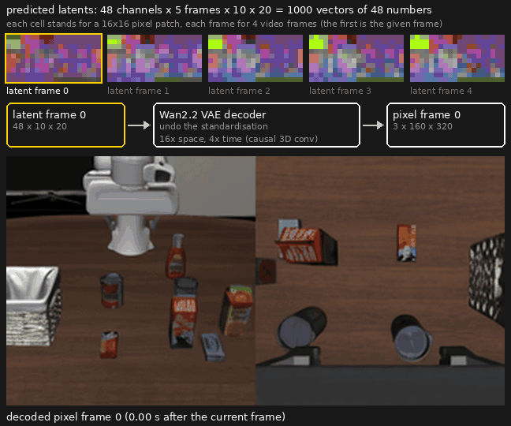
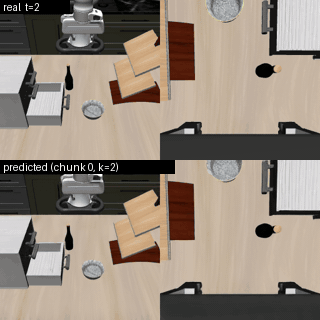
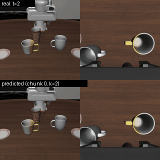

# WAM-eval

Evaluate world action models (WAMs) and related VLAs on LIBERO-10 with [LeRobot](https://github.com/huggingface/lerobot),
using the protocol of each model's card or guide. One environment, one command per policy.

| `./eval.sh <policy>` | checkpoint | what it is | reported on LIBERO-10 | check here |
|---|---|---|---|---|
| `cosmos3` | [`lerobot/Cosmos3-Edge-Policy-LIBERO_10`](https://huggingface.co/lerobot/Cosmos3-Edge-Policy-LIBERO_10) | world action model ([Cosmos 3](https://arxiv.org/abs/2606.02800)): predicts the next 16 frames and the actions jointly | 95.2% (476/500) | 10/10 tasks, 1 episode each |
| `vla-jepa` | [`lerobot/VLA-JEPA-LIBERO`](https://huggingface.co/lerobot/VLA-JEPA-LIBERO) | VLA ([VLA-JEPA](https://arxiv.org/abs/2602.10098)) trained with a V-JEPA2 world-model loss, Qwen3-VL-2B backbone | 96/100 episodes in the LeRobot guide (its table also says 93.0%) | 9/10 tasks, 1 episode each |

The check is one episode per task, to see that the setup works. It is not a replication of the reported numbers: the
full evaluations (500 and 100 episodes) have not been run here.

## Setup

Linux x86_64, one NVIDIA GPU (about 10 GB for Cosmos3, 7 GB for VLA-JEPA), and `git`, `uv`, `cmake`, `g++`, `curl`.

```bash
git clone --recurse-submodules https://github.com/mpodolinsky/WAM-eval && cd WAM-eval
./setup.sh
```

`setup.sh` builds the Python 3.12 environment, including MuJoCo 2.3.7 from source (about a minute). Model weights are
downloaded from the Hub on the first run. Why the environment is built this way, in particular the MuJoCo fix that
evaluations silently depend on: [docs/implementation-notes.md](docs/implementation-notes.md).

## Run

```bash
./eval.sh cosmos3                       # model card protocol: 10 tasks x 50 episodes
./eval.sh vla-jepa                      # LeRobot guide protocol: 10 tasks x 10 episodes
./eval.sh vla-jepa --env.task_ids='[0,1]' --eval.n_episodes=2 --eval.batch_size=1 --output_dir=outputs/smoke
```

Any [`lerobot-eval`](https://huggingface.co/docs/lerobot/libero) flag can be appended and overrides the default (the
last value wins). Results go to `outputs/eval/<policy>/`: `eval_info.json` with the success rate overall and per task,
and a video per episode.

## Cosmos3: the predicted video

Alongside each chunk of 16 actions, Cosmos3 predicts the next 16 frames of both cameras. The policy discards them;
`--policy.save_predicted_video=true` keeps them (as `pred_episode_*.mp4`).

- **Horizon:** 16 frames at 20 fps (0.8 s), the same 16 steps as the action chunk.
- **Picture:** the two cameras shrunk and tiled into one 160x320 image, agentview left and wrist right.
- **Latents:** `[48, 5, 10, 20]` (channels, frames, height, width) of the Wan2.2 VAE: 1000 vectors of 48 numbers.
  Latent frame 0 is the current frame (given); each later one stands for 4 video frames (0.2 s). Each cell is a 16x16
  pixel patch.
- **In the transformer:** 2x2 blocks of cells become 250 tokens (5 frames x 5 x 10) of 192 numbers, projected to the
  backbone width (2048), plus 16 action tokens.

<p align="center">
  
</p>

The five latent frames of one real prediction (task 0), as colour maps of the first three principal components of
their 48 channels. The highlighted one goes through the VAE decoder to the pixel frames below. The decoder undoes the
per-channel standardisation, then upsamples 16x in space and 4x in time after the first frame (5 latent frames become
1 + 4 x 4 = 17 pixel frames; latent frame j gives frames 4j-3 to 4j). It is a causal 3D convolutional network, so the
four frames of one latent frame are not copies. The policy itself never decodes.

**Prediction against reality.** Real frames of the simulator (top) and the frames predicted 1 to 16 steps ahead
(bottom), a new chunk every 16 steps; the first 12 chunks of episode 0 of tasks 0, 3 and 4 (every second frame, in
real time):

<p align="center">
  
  
  
</p>

PSNR in dB between the predicted frame k steps ahead and the real one, averaged over the 12 chunks, against "nothing
moves" (the first frame repeated):

| task | k=1 | k=4 | k=8 | k=16 |
|---|---|---|---|---|
| 0, predicted / nothing moves | 29.7 / 26.2 | 27.4 / 21.2 | 25.7 / 19.0 | 24.1 / 17.5 |
| 3, predicted / nothing moves | 29.5 / 25.7 | 25.8 / 19.8 | 24.1 / 16.9 | 21.8 / 15.3 |
| 4, predicted / nothing moves | 31.2 / 27.4 | 27.2 / 22.0 | 24.8 / 19.7 | 23.6 / 17.9 |

The prediction beats "nothing moves" at every horizon and degrades with it; the decoded current frame itself only
reaches 33 to 35 dB (four chunks of task 0), the limit of the VAE. The video is a sample: other noise seeds give
similar futures that differ in detail. These are three tasks with one episode each, and PSNR measures pixels, not task
success. Reproduce with `uv run --no-sync python scripts/cosmos3_predicted_video.py --task-id 0 --chunks 12
--detail-chunks 0,7` (about 11 GB of GPU memory); it writes the GIFs, `metrics.json` and figures of the denoising and
of other noise seeds to `outputs/cosmos3_predicted_video/`.

## Licence

The code is Apache-2.0. The model weights keep their own licences (Cosmos3: [OpenMDW-1.1](https://openmdw.ai/license/1-1/);
VLA-JEPA: Apache-2.0) and are not part of this repository, nor are the Qwen3-VL and V-JEPA2 weights VLA-JEPA loads.
LeRobot (Apache-2.0) and LIBERO (MIT) keep theirs.

## References

- NVIDIA Cosmos Team, *Cosmos 3: Omnimodal World Models for physical AI*, 2026. [arXiv:2606.02800](https://arxiv.org/abs/2606.02800)
- *VLA-JEPA*, 2026. [arXiv:2602.10098](https://arxiv.org/abs/2602.10098)
- [LeRobot](https://github.com/huggingface/lerobot); [LIBERO](https://github.com/Lifelong-Robot-Learning/LIBERO)
