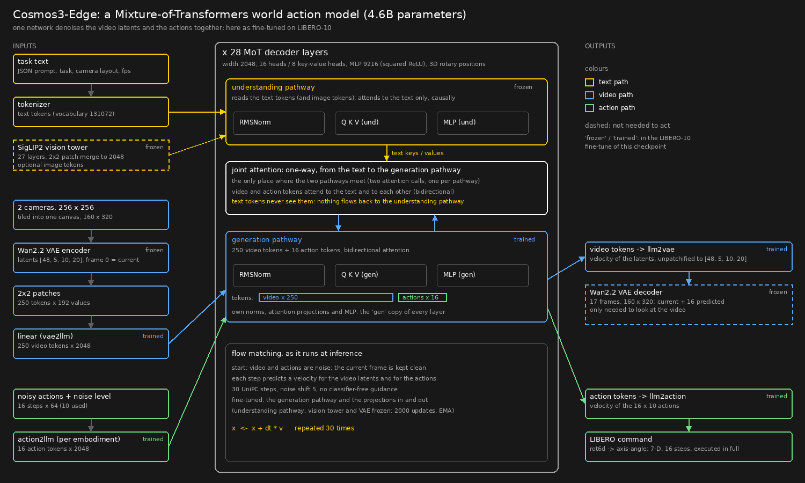

# Cosmos3

Scripts for [`lerobot/Cosmos3-Edge-Policy-LIBERO_10`](https://huggingface.co/lerobot/Cosmos3-Edge-Policy-LIBERO_10).
Evaluate it with `./eval.sh cosmos3` (see the [main README](../../README.md)).

  

Cosmos3-Edge is a Mixture-of-Transformers world action model of 4.6B parameters. Every one of its 28 decoder layers
(width 2048, 16 heads / 8 key-value heads) has two pathways with their own norms, attention projections and MLPs:

- the **understanding pathway** reads the text prompt, and optionally image tokens from a SigLIP2 vision tower, with
  causal attention;
- the **generation pathway** reads the video latents (Wan2.2 VAE, `[48, 5, 10, 20]` as 250 tokens) and the 16 action
  tokens, with bidirectional attention.

The pathways meet only in the attention, and only one way: the generation tokens read the text's keys and values, while
the text tokens attend to the text alone and never see the video or the actions (the code's "two-way" attention
means two attention calls, one per pathway). The network predicts a flow-matching velocity for the video and the
actions together, and 30 UniPC steps turn noise into a 16-step action chunk and the next 16 frames. In the LIBERO-10
fine-tune only the generation pathway and the projections in and out were trained; the understanding pathway, the vision
tower and the VAE were frozen.

| script | what it does |
|---|---|
| [`predicted_video.py`](predicted_video.py) | compares the video Cosmos3 predicts with the real frames of a closed-loop episode: GIFs, PSNR, denoising figures (see "Cosmos3: the predicted video" in the main README) |
| [`architecture_diagram.py`](architecture_diagram.py) | draws `architecture.png` |
